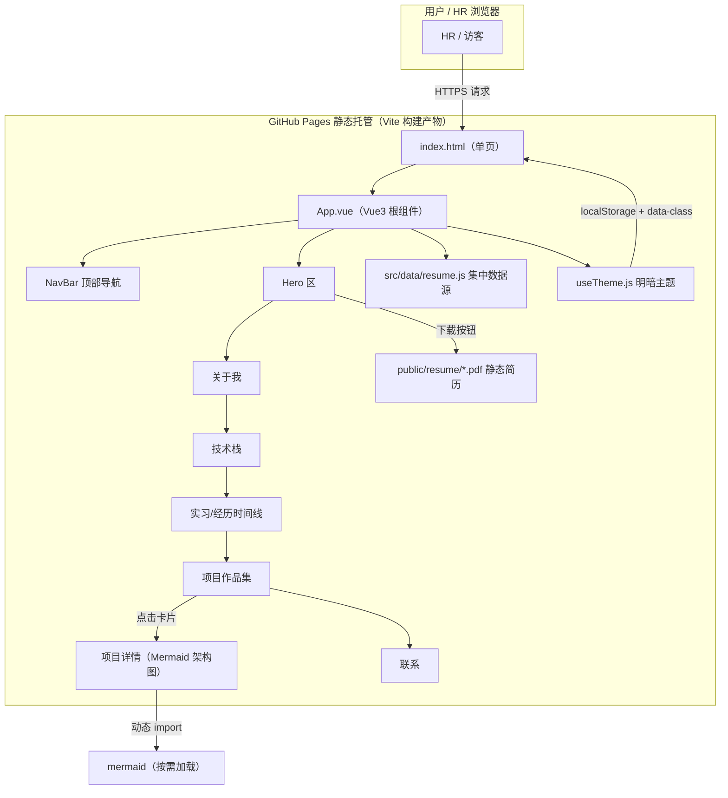
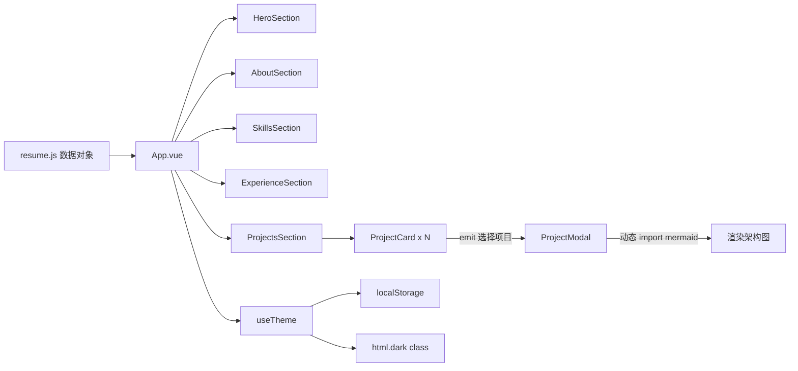

# 03 · 架构设计

> 本架构说明「Resume-」站点的整体结构、模块划分与页面组织。项目为**纯静态前端**，无后端、无数据库。

---

## 一、整体架构



**关键点**：
- 单页应用，无前端路由，靠锚点滚动串联各区块；
- 简历内容与页面逻辑分离，集中在 `resume.js`；
- Mermaid 通过动态 import 按需加载，不进入首屏体积。

---

## 二、模块划分

| 模块 | 文件 | 职责 |
| --- | --- | --- |
| 根组件 | `src/App.vue` | 组装所有区块，维护主题状态 |
| 数据源 | `src/data/resume.js` | 全部简历数据（基本信息/技能/项目/经历/荣誉） |
| 主题逻辑 | `src/composables/useTheme.js` | 明暗主题切换、localStorage 记忆、系统偏好 |
| 滚动入场 | `src/utils/scrollReveal.js` | 区块进入视口时的轻量入场动画（尊重 reduced-motion） |
| 顶部导航 | `src/components/NavBar.vue` | 锚点导航 + 主题切换按钮，移动端汉堡菜单 |
| Hero 区 | `src/components/HeroSection.vue` | 姓名/岗位/简介/下载按钮/社交图标 |
| 关于我 | `src/components/AboutSection.vue` | 个人简介、求职意向、教育、荣誉 |
| 技术栈 | `src/components/SkillsSection.vue` | 分组技能标签 |
| 经历时间线 | `src/components/ExperienceSection.vue` | 教育 + 实习垂直时间线 |
| 项目作品集 | `src/components/ProjectsSection.vue` | 项目卡片网格 |
| 项目卡片 | `src/components/ProjectCard.vue` | 单张项目卡片 |
| 项目详情 | `src/components/ProjectModal.vue` | 详情弹窗（背景/架构图/难点/成果） |
| 联系 | `src/components/ContactSection.vue` | 邮箱/电话/GitHub/Gitee |
| 页脚 | `src/components/FooterSection.vue` | 版权信息、返回顶部 |
| 全局样式 | `src/style.css` | Tailwind 引入 + 主题 CSS 变量 |

---

## 三、目录结构

```
My_repository/
├── docs/                      # 全部文档（01-06）
│   ├── 01-需求分析.md
│   ├── 02-技术选型.md
│   ├── 03-架构设计.md
│   ├── 04-UI调研总结.md
│   ├── 05-部署方案.md
│   └── 06-开发计划&分步记录.md
├── public/
│   ├── favicon.svg
│   └── resume/                # ATS 友好简历 PDF
│       └── Resume-NiuRuntian.pdf
├── src/
│   ├── main.js
│   ├── App.vue
│   ├── style.css
│   ├── data/resume.js         # 集中数据源
│   ├── composables/useTheme.js
│   ├── utils/scrollReveal.js
│   └── components/            # 各区块组件
├── index.html
├── package.json
├── vite.config.js
├── tailwind.config.js
├── postcss.config.js
├── README.md
└── .gitignore
```

---

## 四、页面结构说明

### 4.1 区块顺序（单页锚点）

```
#hero → #about → #skills → #experience → #projects → #contact
```

### 4.2 各区块要点

- **Hero**：左文字右留白，姓名 + 岗位 + 一句话定位 + 双 CTA（下载简历 / 查看项目）+ 社交图标；
- **关于我**：简介段落 + 求职意向 + 教育信息 + 在校荣誉；
- **技术栈**：按「Java 后端 / AI 大模型 / 前端 / 中间件&运维 / 其他」分组，标签形式展示，无进度条；
- **经历时间线**：教育（2022.09–2026.06）与实习（2026.04–2026.08）两条时间线；
- **项目作品集**：2 个项目卡片（智慧养老平台、家政 O2O 平台），点击弹出详情；
- **联系**：邮箱、电话、GitHub、Gitee 图标链接。

---

## 五、数据流



- 所有展示内容均来自 `resume.js`，无任何硬编码散落；
- 项目详情弹窗由卡片点击触发，选中项目 id 传入 Modal，读取对应项目数据；
- 架构图字符串存放在数据文件的 `architecture` 字段，由 Mermaid 渲染。
