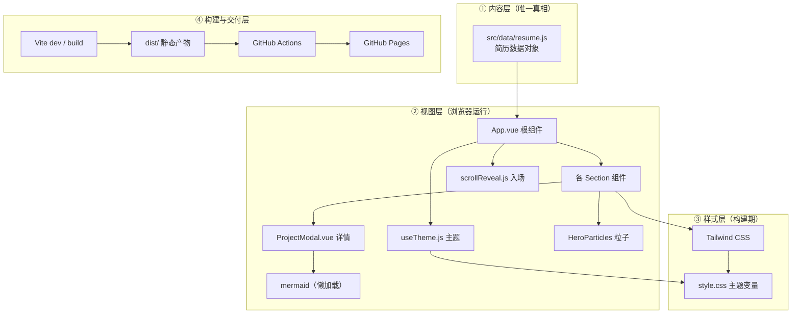

# 07 · 开发思路与技术栈详解

> 本文回答两个问题：
> ① 这个项目「是怎么想、怎么一步步做出来的」（开发思路与指导）；
> ② 站内每个技术分别是什么、在项目里承担什么角色、它们之间如何配合（技术栈详解与协作关系）。
> 全部资料来源附在文末，可溯源。

---

## 一、开发思路与指导

### 1.1 一句话概括

一个「内容与展示分离」的纯静态单页作品集：**所有简历数据集中在一个 JS 对象里**，**所有 UI 由 Vue 组件消费这些数据渲染**，**Tailwind 负责全部样式**，**Vite 负责开发与打包**，**GitHub Actions 负责把打包产物发布到 GitHub Pages**。

整条链路没有一行后端代码、没有一个数据库表——这是刻意的选择，理由见 [02-技术选型](02-技术选型.md)。

### 1.2 贯穿全项目的核心开发原则

| 原则 | 具体做法 | 为什么 |
| --- | --- | --- |
| 先文档后代码 | 需求→选型→架构→调研→记录，每一步落盘 `docs/` | 计划模式要求；也方便日后复现、复盘 |
| 单一数据源 | 简历只写在 `src/data/resume.js` | 改一次全站生效，杜绝多处分叉不一致 |
| 不编造经历 | 缺失内容（截图、实习职责）宁可留空/占位 | 网站内容 = PDF 内容 = 真实经历 |
| 可读性优先 | 少强调色、克制动效、清晰层级 | 受众是 HR，不是炫技比赛 |
| 性能优先 | 无后端、代码分割（Mermaid 懒加载）、静态资源 | 首屏快、加载稳 |
| 可访问性 | 尊重 `prefers-reduced-motion`、`aria-label`、语义标签 | 对使用辅助技术的人友好 |
| 一切可回归 | 开发记录 + README + 目录说明 | 几个月后回看仍能看懂 |

### 1.3 推荐的分步开发流程（可复用到同类项目）

1. **需求分析**（[01-需求分析](01-需求分析.md)）：功能清单 + HR 视角 + 非功能约束（性能/兼容/体积）。
2. **技术选型**（[02-技术选型](02-技术选型.md)）：先定「纯静态托管」这个大前提，再在框架/样式/图表里挑。
3. **UI 调研**（[04-UI调研总结](04-UI调研总结.md)）：GitHub 搜同类仓库，记录「借鉴点 + 需要规避的坑」。
4. **架构设计**（[03-架构设计](03-架构设计.md)）：画整体图 + 数据流图，定模块边界。
5. **工程骨架**：Vite + Vue + Tailwind 初始化，配好 `base`、`darkMode: 'class'`。
6. **数据源先行**：先写 `resume.js`，UI 只负责消费它。
7. **组件逐个落地**：Nav → Hero → About → Skills → Experience → Projects → Contact → Footer。
8. **主题与动效**：`useTheme` + `scrollReveal` + 粒子/3D（克制）。
9. **配套 PDF**：脚本从数据源生成，保证与网站一致。
10. **自测 → 打包 → 推送 → 部署**（[05-部署方案](05-部署方案.md)、[06-开发计划&分步记录](06-开发计划&分步记录.md)）。

### 1.4 来自本项目实战的踩坑提示

- **Windows 构建报错** `remove ...\Temp\esbuild-...: Access is denied`：把 `TMP`/`TEMP` 重定向到工作区（如 `D:\DS_WorkArea\.tmp`）再 `npm run build`。
- **子路径 404**：`vite.config.js` 必须写 `base: './'`，否则部署到 `/<repo>/` 下资源加载失败。
- **深色模式对比度**：按钮/标签文字用 `--c-accent-contrast` 而不是写死白色，保证深浅两套主题都可读。
- **Mermaid 体积大**（约 700KB）：必须用动态 `import('mermaid')` 懒加载，不要进首屏。
- **PAT 权限**：推送 `.github/workflows/*` 需要 token 带 `workflow` 权限。
- **下载文件名**：PDF 用 ASCII 文件名 + `download` 属性指定中文名，避免浏览器对中文 URL 编码不一致。

---

## 二、技术栈逐项详解

### 2.1 Vue 3 —— 视图层

- **是什么**：渐进式 JavaScript 前端框架，用响应式数据驱动 DOM。
- **本项目用法**：全部组件用 `<script setup>` 语法（Composition API），例如 `App.vue` 中
  ```js
  const resumeData = resume
  const { theme, toggleTheme } = useTheme()
  const { observe } = useScrollReveal()
  onMounted(() => observe())
  ```
  组件间通过 `props` 向下传数据（如 `ProjectsSection` 把 `resumeData.projects` 传给 `ProjectCard`），通过 `emits` 向上抛事件（如 `ProjectCard` 点击后 `emit('open', project)`，`ProjectsSection` 把选中的项目传给 `ProjectModal`）。
- **关键机制**：`ref()` 定义响应式基础值，`computed()` 派生数据，`onMounted` 挂载后执行副作用。Vue 通过编译把模板转成渲染函数，数据变化时只更新对应 DOM 块（性能好、写法直观）。
- **为什么选它**：生态成熟、文档中文完善、单文件组件（SFC）把模板/逻辑/样式放一个文件里，适合这种「区块多、结构清晰」的页面。

### 2.2 Vite —— 构建工具与开发服务器

- **是什么**：基于原生 ES Modules 的前端构建工具，开发时按需编译、秒级热更新（HMR），生产构建用 Rollup 打包。
- **本项目用法**（`vite.config.js`）：
  ```js
  export default defineConfig({
    base: './',                       // 相对路径，适配 GitHub Pages 子路径
    plugins: [vue()],                 // 编译 .vue 单文件组件
    build: {
      rollupOptions: {
        output: { manualChunks: { mermaid: ['mermaid'] } } // 把 mermaid 拆成独立 chunk
      }
    }
  })
  ```
- **关键机制**：`npm run dev` 启动 dev server（默认 5173），修改文件即 HMR 更新；`npm run build` 走 Rollup 把 `index.html` + 所有模块打包进 `dist/`；`base: './'` 决定产物里资源引用是 `./assets/...` 还是绝对路径。
- **为什么选它**：Vue 官方推荐，开箱即用，构建快，配置少。

### 2.3 Tailwind CSS —— 原子化样式层

- **是什么**：utility-first 的 CSS 框架，用一堆小类名（`flex`、`px-4`、`text-sm`）直接拼装样式，不写传统 CSS 选择器。
- **本项目用法**：
  - `tailwind.config.js` 里 `darkMode: 'class'`（主题由 `html.dark` 类控制），并把颜色全部指向 CSS 变量：
    ```js
    colors: {
      bg: 'var(--c-bg)', surface: 'var(--c-surface)',
      border: 'var(--c-border)', ink: 'var(--c-ink)',
      muted: 'var(--c-muted)', accent: 'var(--c-accent)',
      'accent-contrast': 'var(--c-accent-contrast)'
    }
    ```
  - `src/style.css` 用 `@tailwind base/components/utilities` 引入三层，再用 `@layer components` 定义可复用类（`.btn-primary`、`.tag`、`.card`）。
- **关键机制**：构建时扫描 `content` 里列出的文件，只生成用到的原子类（JIT，产物体积小）；`dark:` 前缀在 `html.dark` 下生效。
- **为什么选它**：不写 CSS 文件、改样式只改类名、响应式与暗色开箱即用，且最终 CSS 很小。

### 2.4 JavaScript 原生 ES Modules

- **是什么**：浏览器原生支持的模块系统（`import`/`export`），也是 Vite 能「按需编译、懒加载」的基础。
- **本项目用法**：
  - 所有 `.js`/`.vue` 都用 `import` 组织（`main.js` → `App.vue` → 各组件 → `resume.js`）。
  - `ProjectModal.vue` 用动态导入实现懒加载：
    ```js
    const { default: mermaid } = await import('mermaid')
    ```
    这样 Mermaid 只在打开项目详情时才下载，首屏不背这 ~700KB。
- **为什么用它**：无需额外模块系统，Vite 直接消费原生 ESM，代码分割顺理成章。

### 2.5 Mermaid —— 架构图渲染

- **是什么**：把文本（`graph TD; A-->B` 这种）渲染成 SVG 图表的 JS 库。
- **本项目用法**：项目数据里的 `architecture` 字段存 Mermaid 文本，`ProjectModal.vue` 在弹窗打开时：
  ```js
  mermaid.initialize({ startOnLoad: false, theme: 'neutral' })
  const { svg } = await mermaid.render(id, project.architecture)
  // 再把 svg 插入容器
  ```
- **关键机制**：同步/异步 `render()` 输出 SVG 字符串；`theme: 'neutral'` 保证在深色弹窗里也清晰（深色下另有容器样式适配）。
- **为什么选它**：不依赖图片、可版本化（改文本即改图）、渲染清晰、无需额外设计工具。

### 2.6 PostCSS + Autoprefixer —— CSS 后处理

- **是什么**：PostCSS 是 CSS 转换管道，Autoprefixer 是其中常用的插件，自动补浏览器前缀。
- **本项目用法**（`postcss.config.js`）：`tailwindcss` + `autoprefixer` 两个插件。Tailwind 本质就是一个 PostCSS 插件，Vite 构建时自动调用。
- **为什么需要**：让 `flex`、`grid` 等现代属性在旧浏览器里也能正常显示（虽然目标用户多为新浏览器，但成本极低、收益稳定）。

### 2.7 Node.js + npm —— 工具链运行时

- **是什么**：Node.js 是让 JS 跑在浏览器外的运行时；npm 是包管理器。
- **本项目用法**：`npm install` 安装依赖，`npm run dev/build/preview` 执行脚本，`package.json` 声明依赖与命令。
- **为什么需要**：Vite、Vue 编译器、Tailwind 都运行在 Node 环境；纯静态站点只是「运行时不依赖 Node」，但「构建时」必须有。

### 2.8 GitHub Actions + GitHub Pages —— 部署层

- **是什么**：Actions 是 CI/CD 自动化，Pages 是静态站点托管。
- **本项目用法**（`.github/workflows/deploy.yml`）：
  ```yaml
  on:
    push: { branches: [main] }
  jobs:
    build:  # checkout → setup-node 20 → npm ci → npm run build → upload-pages-artifact(dist)
    deploy: # deploy-pages 发布到 Pages
  ```
  每次推送到 `main` 自动构建并发布，产出 `https://<用户名>.github.io/<仓库名>/`。
- **关键机制**：`upload-pages-artifact` 把 `dist/` 打成 artifact，`deploy-pages` 把它发布成 Pages 站点；权限需 `pages: write` 与 `id-token: write`。
- **为什么选它**：零成本、零运维、与仓库天然集成，符合「纯静态」定位。

### 2.9 python-docx + LibreOffice —— 简历 PDF 生成链路

- **是什么**：`python-docx` 用 Python 生成/编辑 Word（.docx）；LibreOffice 负责把 DOCX 转成 PDF。
- **本项目用法**：`scripts/generate_resume.py` 读取简历内容，用 python-docx 生成**单栏、无表格、无图片**的 ATS 友好 DOCX（微软雅黑 + Arial，CJK 文本显式设置 `w:eastAsia` 字体），再用 LibreOffice Kit 转 `public/resume/Resume-NiuRuntian.pdf`。
- **为什么这么绕**：ATS 解析 PDF 时，单栏纯文本 + 标准字体最稳；DOCX 便于微调、PDF 便于投递。网站下载按钮直接指向这份 PDF，保证「网站描述 = PDF 内容」。

---

## 三、技术栈之间的逻辑配合关系

技术栈不是孤立罗列的，它们分属**四个层次**，通过两种「流」连接：

### 3.1 分层总览



### 3.2 两种「流」把四层串起来

**（A）运行时数据流（浏览器里）**

```
resume.js（数据）
   └─→ App.vue（import resume，按区块拆分 props）
         ├─→ HeroSection / AboutSection / SkillsSection / ExperienceSection / ProjectsSection / ContactSection
         ├─→ useTheme()       → 切换 html.dark → Tailwind 的 dark: 类与 CSS 变量生效
         ├─→ useScrollReveal()→ IntersectionObserver 给 .reveal 区块加 .is-visible
         └─→ ProjectsSection → ProjectCard(点击 emit) → ProjectModal
                                     └─→ 动态 import('mermaid') → 渲染 architecture 字段
```

**（B）构建与发布流（命令行 / CI 里）**

```
源码（.vue/.js/.css/.html）
   └─→ Vite（vue 插件编译 SFC + PostCSS 调 Tailwind/Autoprefixer 生成 CSS）
         └─→ Rollup 打包 → 代码分割（mermaid 独立 chunk）→ dist/
               └─→ git push main → GitHub Actions：npm ci → npm run build → upload artifact
                     └─→ deploy-pages → https://<user>.github.io/<repo>/
```

**（C）PDF 链路（离线工具链）**

```
resume.js 内容（人工同步）
   └─→ generate_resume.py（python-docx）→ scripts/Resume-NiuRuntian.docx
         └─→ LibreOffice 转 PDF → public/resume/Resume-NiuRuntian.pdf
               └─→ 网站「下载简历」按钮直接指向它（download 属性给中文文件名）
```

### 3.3 为什么这样配合（逐条说明）

| 配合关系 | 说明 |
| --- | --- |
| `resume.js` → 所有组件 | 内容与视图解耦：改简历只改一个文件，全站同步刷新，杜绝「首页改了、PDF 没改」 |
| `useTheme` → `html.dark` → Tailwind `dark:` | 按「类名」而非媒体查询控制主题，用户可手动切换且可记忆；CSS 变量让颜色定义只写一处 |
| `scrollReveal` → `.reveal` | 用 `IntersectionObserver`（浏览器原生 API）代替滚动监听，性能好且不阻塞主线程 |
| 组件 → `mermaid`（动态 import） | 首屏不含大体积图表库，打开详情才按需下载；Mermaid 文本存数据里，改图即改文本 |
| Vite `base: './'` → Pages 子路径 | 产物资源用相对路径引用，部署到 `/<repo>/` 根下也不会 404 |
| Actions → `dist/` | 构建产物不提交进仓库（由 CI 每次构建），仓库干净、可复现 |
| PDF 脚本 → 同一数据源 | 人工同步内容，保证「网站 = 简历 PDF」零偏差（ATS 友好：单栏、无表格、标准字体） |

### 3.4 各技术「谁依赖谁」速查

- `Vue` 依赖 `Vite`（编译）和 `Tailwind`（样式类）——但它本身是运行时框架。
- `Tailwind`、`PostCSS`、`Autoprefixer` 在**构建期**工作，不出现在运行时产物逻辑里（只留下生成的 CSS）。
- `Mermaid` 是**运行时懒加载**的大依赖，被 `ProjectModal` 通过动态 `import` 引用。
- `GitHub Actions`、`Pages` 是**交付期**工具，不进入前端代码。
- `python-docx`、`LibreOffice` 是**离线文档工具链**，与网站运行时完全独立，只通过「同一份简历内容」与网站保持一致。

---

## 四、资料来源（官方文档与规范）

按技术归类，均为可溯源官方/权威链接：

| 技术 | 资料来源 |
| --- | --- |
| Vue 3 | https://cn.vuejs.org/guide/ |
| Vite | https://cn.vitejs.dev/guide/ |
| Tailwind CSS | https://tailwindcss.com/docs |
| Mermaid | https://mermaid.js.org/intro/ |
| MDN：IntersectionObserver | https://developer.mozilla.org/zh-CN/docs/Web/API/IntersectionObserver |
| MDN：CSS 自定义属性 | https://developer.mozilla.org/zh-CN/docs/Web/CSS/Using_CSS_custom_properties |
| MDN：prefers-color-scheme | https://developer.mozilla.org/zh-CN/docs/Web/CSS/@media/prefers-color-scheme |
| MDN：prefers-reduced-motion | https://developer.mozilla.org/zh-CN/docs/Web/CSS/@media/prefers-reduced-motion |
| MDN：Canvas API | https://developer.mozilla.org/zh-CN/docs/Web/API/Canvas_API |
| GitHub Actions | https://docs.github.com/zh/actions |
| GitHub Pages | https://docs.github.com/zh/pages |
| deploy-pages action | https://github.com/actions/deploy-pages |
| python-docx | https://python-docx.readthedocs.io/ |
| LibreOffice | https://www.libreoffice.org/ |
| Node.js | https://nodejs.org/zh-cn |
| npm | https://docs.npmjs.com/ |

> 若需补充「UI/设计参考」类来源，见 [04-UI调研总结](04-UI调研总结.md)（含 21 个真实开源仓库链接）。
